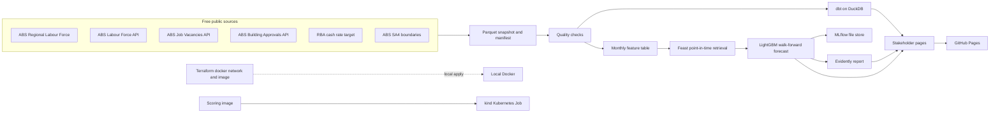

# Jobs Risk Radar

Which Australian regions are most likely to see unemployment rise over the next three months, now that the cash rate target is 4.85%?

On 3 November 2026 the Reserve Bank's Monetary Policy Board raised the cash rate target by 0.25 percentage points. The new target, 4.85%, took effect on 4 November. It is the fifth increase of 2026 and the highest target since 2008. The November Statement on Monetary Policy says unemployment has risen faster than the Bank expected in August, and it projects the national rate at 4.8% by December 2026 and about 5.1% by the end of 2028.

That national path does not say where the pressure shows up first. This project is an early-warning radar for the 87 ABS labour-market regions (SA4s, with Western Australia's two outback regions combined the way the ABS publishes them) and for the states. It is built so a state government, an employment-service provider, or a job seeker can see where the rate has already jumped, and where the next three months look different from the usual end-of-year pattern.

The stakeholder briefing is a static site, not a technical console:

**https://luciferdataengineer.github.io/jobs-risk-radar/**

[](https://github.com/LuciferDataEngineer/jobs-risk-radar/actions/workflows/ci.yml)
[](https://github.com/LuciferDataEngineer/jobs-risk-radar/actions/workflows/kind.yml)
[](https://github.com/LuciferDataEngineer/jobs-risk-radar/actions/workflows/pages.yml)

Numbers below are computed from the committed snapshot. The working notes are in [INSIGHTS.md](INSIGHTS.md). Times on the site are Australia/Melbourne.

## Architecture



Dagster exposes the same stages as assets (`checked_snapshot`, `warehouse`, `historical_features`, `scored_regions`, `drift_report`, `stakeholder_site`). `make pipeline` runs each stage once. Materialising the Dagster graph runs the same functions, passing outputs between assets.

## What's new vs the previous project

Portfolio project 9, [elective-wait-metrics](https://github.com/LuciferDataEngineer/elective-wait-metrics), was a semantic-layer metrics platform: Polars, dbt-duckdb, dbt MetricFlow saved queries, Dagster, and Great Expectations Data Docs published on Pages. Earlier projects covered streaming (Redpanda), Iceberg merge-on-read, Trino, OpenLineage/Marquez, and DuckDB vector search.

This project keeps DuckDB, dbt, Dagster and Polars, and adds a forecasting platform plus local infrastructure-as-code:

| Added here | Why |
| --- | --- |
| Feast feature store, DuckDB offline and SQLite online | Point-in-time retrieval so a later unemployment rate cannot leak into an earlier decision |
| LightGBM regression and classification, walk-forward backtest | The decision is a forecast, not a historical metric. Two simple rules are the baseline |
| MLflow file store | The backtest metrics and the fitted regressor are tracked locally, with no hosted tracker |
| Evidently drift report at `/drift/` | The 2024–2026 scored window does not look like 2020–2022. That shift is published, not hidden |
| Kubernetes Job on kind, in GitHub Actions | The score runs from a locally built image inside a real cluster, on the free Actions tier |
| Terraform with the Docker provider | The local network and image build are declared and checked with `fmt` and `validate`. No cloud provider |

MetricFlow saved queries and Great Expectations Data Docs were the centre of project 9. They are not repeated here. Quality is dbt tests plus an explicit check that the September 2026 regional employment total matches the ABS workbook, and monitoring is the drift report.

## Tech stack

| Piece | Choice | Why |
| --- | --- | --- |
| Warehouse | DuckDB | One file, SQL the marts can test, no hosted database |
| Transform | dbt-duckdb | Staging views and two marts, with data tests in CI |
| Frame engine | Polars | Region rollups, lags and as-of joins without a cluster |
| Feature store | Feast 0.45, DuckDB offline, SQLite online | Historical retrieval is as-of the decision month. The online store holds the latest month for a live lookup |
| Forecast | LightGBM via scikit-learn | Gradient boosting on a few thousand rows trains in seconds and handles missing values |
| Tracking | MLflow local file store | Metrics and the regressor stay in the repo's run directory, which is gitignored |
| Drift | Evidently 0.4 | One HTML report comparing scored quarters in 2020–2022 with 2024–2026 |
| Orchestration | Dagster assets | The stage graph is importable in CI. The pipeline function is what CI executes |
| Containers | Docker, kind, a Kubernetes Job | CI builds the image, loads it into kind, and waits for the Job |
| Infrastructure | Terraform, `kreuzwerker/docker` 3.0.2 | Declares the local Docker network and the image build. CI validates. It does not apply, so it does not fight the kind job |
| Stakeholder site | Static HTML, Leaflet, Chart.js | Four tabs, no build step, deployed by GitHub Pages |
| Quality gate | pytest, ruff, dbt tests, snapshot checks | CI fails if the national rate, the cash-rate target, or the region count drifts |

Everything is open source. Nothing in the pipeline calls a paid API or a cloud warehouse.

## Data sources

All of these were free to read on 9 November 2026 (Australia/Melbourne). Checksums, row counts and the access note are in [`data/manifest.json`](data/manifest.json).

| Publisher | Series | URL | Licence | Coverage | Note |
| --- | --- | --- | --- | --- | --- |
| Australian Bureau of Statistics | Regional Labour Force, modelled SA4 estimates (MLF1) | [September 2026 release](https://www.abs.gov.au/statistics/labour/employment-and-unemployment/regional-labour-force/sep-2026) | CC BY 4.0 | 87 regions, January 2012–September 2026 | First issue of this release, published 22 October 2026. Age and sex are summed to persons. The cube header still says ASGS 2011; the region list matches ASGS Edition 3, with the two WA outback regions combined as code 508 |
| Australian Bureau of Statistics | Labour Force, unemployment rate | [Data API, dataflow LF](https://data.api.abs.gov.au/rest/data/LF/M13.3.1599.20.AUS+1+2+3+4+5+6.M?startPeriod=2012-01&format=csv) | CC BY 4.0 | Seasonally adjusted, persons 15+, Australia and states, monthly | Key `M13.3.1599.20`. Region codes 7 and 8 returned no records, so the Northern Territory and the ACT are not in this extract |
| Australian Bureau of Statistics | Job Vacancies | [Data API, dataflow JV](https://www.abs.gov.au/statistics/labour/jobs/job-vacancies-australia/latest-release) | CC BY 4.0 | Original vacancies, total sectors and industries, states and Australia, 2012 Q1–2026 Q3, thousands | Substitute for the Jobs and Skills Australia Internet Vacancy Index. The JSA host timed out, then failed with an HTTP/2 error, on 9 November 2026. These figures are quarterly and by state, not SA4 job ads |
| Australian Bureau of Statistics | Building Approvals, dwelling units | [Data API, dataflow BA_GCCSA](https://www.abs.gov.au/statistics/industry/building-and-construction/building-approvals-australia/latest-release) | CC BY 4.0 | Number of dwelling units, total residential, states and Australia, January 2015–September 2026 | Measure 1, value 1, sector 9, original |
| Reserve Bank of Australia | Cash rate target, table F1 series FIRMMCRTD | [Cash rate](https://www.rba.gov.au/statistics/cash-rate/) and [F1 daily workbook](https://www.rba.gov.au/statistics/tables/xls/f01d.xlsx) | RBA website statistics, attribution required | Month-end target from the daily series, through 6 November 2026 | Only the cash-rate target was copied. Bank-bill and swap columns in F1 are third-party market data and were not copied |
| Australian Bureau of Statistics | SA4 2021 digital boundaries | [ASGS Edition 3 boundary files](https://www.abs.gov.au/statistics/standards/australian-statistical-geography-standard-asgs-edition-3/jul2021-jun2026/access-and-downloads/digital-boundary-files) | CC BY 4.0 | Simplified GeoJSON, outback north and south dissolved to region 508 | A display file, not a legal boundary |

The snapshot is the parquet in `data/snapshot/` plus `data/boundaries/sa4.geojson`. Rebuild it from the workbooks with `JRR_RAW=/path/to/downloads python -m jrr.build_snapshot`, or pass `--download` to fetch the URLs again. CI uses the committed snapshot so a source outage does not fail the build.

## Cleaning and transformation

1. The ABS age-by-sex cube is summed to persons for each region and month. Youth (15–24) is kept as its own unemployment rate. Unemployment is unemployed divided by employed plus unemployed. Participation includes those not in the labour force.
2. A reconciliation check requires the September 2026 sum of employed persons across the 87 regions to match the Australia total in the same workbook (14,743.8 thousand).
3. Official state rates stay seasonally adjusted. They are not mixed into the regional level on the map.
4. State job vacancies are carried forward from the quarter that has already ended. Dwelling approvals are joined by state and month. Year-on-year changes use a 12-month or four-quarter lag.
5. The cash-rate feature for a historical month is the target on the last published day of that month. The live score, which uses September labour data because that is the latest regional release, replaces the cash-rate inputs with the target in force on 9 November 2026 (4.85%, and the change from three months earlier). That adjustment is recorded in `reports/backtest.json` and is not applied inside the backtest.
6. The label is the unemployment rate three months ahead minus the rate in the decision month. It is not stored in the feature view.

## Data model

DuckDB tables and views, built by dbt:

| Model | Grain | What it holds |
| --- | --- | --- |
| `stg_sa4_labour` | region × month | Modelled rates, labour force, participation, youth rate |
| `stg_state_unemployment` | state or Australia × month | Seasonally adjusted unemployment rate |
| `stg_job_vacancies` | state or Australia × quarter | Original job vacancies, thousands |
| `stg_building_approvals` | state or Australia × month | Dwelling units approved |
| `stg_cash_rate` | month | Cash rate target |
| `mart_region_latest` | region | Latest modelled rate and the change over three months |
| `mart_state_latest` | state or Australia | Latest official rate and the change over a year |

dbt tests reject a duplicate region-month, a null rate, and any unemployment rate outside 0–40%.

## Forecast

**Question.** At each region and month, how much will the unemployment rate change over the next three months?

**Features known in that month.** The current rate and its 3- and 12-month changes, the change over the same three months a year earlier, participation and its change, the youth rate and its change, employment growth, state vacancies and their year-on-year change, state dwelling approvals and their year-on-year change, the cash rate and its three-month change, the state's official unemployment rate and its change, and whether that state rate is the official series or the national stand-in used for the Territory and the ACT. Calendar month and state code are added beside the feature store.

**Point in time.** Feast's DuckDB offline store joins those features as of the decision timestamp. A unit test checks that the rate retrieved for June 2024 is the June 2024 rate, and that the label equals September 2024 minus June 2024. The online SQLite store is materialised for the latest month.

**Models.** A LightGBM regressor predicts the size of the change. A LightGBM classifier predicts whether the change is at least 0.3 points. Both use 120 trees, learning rate 0.06, and a fixed seed.

**Backtest.** For every quarter-end from March 2020 through June 2026, the models train only on origins whose three-month outcome was already known, then score that quarter. That is 26 origins and 2,262 region-quarters. Two rules are the comparison: repeat the change from the same three months last year, and repeat the change from the last three months.

| Check | Result |
| --- | --- |
| Average error, this outlook | 0.50 points |
| Average error, repeat last year's move | 0.60 points |
| Average error, repeat the last quarter | 0.72 points |
| Rank agreement with what happened (average Spearman) | 0.32 |
| Of the 10 regions named as the biggest moves, how many really were | about 3 |
| Share of quarters with a rise of 0.3 points or more | 24% |
| Yes/no call accuracy at that 0.3 point line | 74% |
| Accuracy of always saying "no material rise" | 76% |

The size forecast beats both simple rules. The yes/no call does not beat "assume there is no material rise", because most region-quarters do not rise by 0.3 points. The site therefore leads with the size of the move, and it says the past check found about 3 of 10 named regions. It does not claim a sharp yes/no alarm.

**Live score.** The production model is fit on every origin through June 2026 (14,094 labelled rows) and applied to September 2026, with the cash rate set to the 4.85% target now in force. September is the latest regional release, so December is the quarter being described.

**Drift.** Evidently compares the feature values and the predicted change on scored quarters in 2020–2022 (1,044 rows) with 2024–2026 (870 rows). The report flags a shift in 20 of the 21 columns. The HTML is published at `/drift/` for a technical reader. The stakeholder pages do not mention it.

**Vintage limit.** The modelled regional history was released as one vintage on 22 October 2026. The backtest never uses a future row as a feature, but it also cannot replay what would have been published at the time, because this history did not exist as a monthly release before that date. Treat the error figures as a check on the published history, not as a real-time track record.

## What the numbers say

A short version is on the site. The quantified findings are in [INSIGHTS.md](INSIGHTS.md). The headlines:

- Australia's official unemployment rate was **4.7%** in September 2026, up from **4.4%** a year earlier. The cash rate target is **4.85%**, the fifth increase of 2026.
- From June to September 2026 the typical region rose **0.2 points**. In 2023, 2024 and 2025 that same three months moved by about **0.1 points or less**. **23 regions** are up by half a point or more. Sydney - Parramatta is up **1.9 points**, to **6.7%**.
- New South Wales went from **4.2% to 4.7%**. Victoria is **5.1%** and Tasmania **5.0%**. South Australia went the other way, from **4.5% to 4.2%**. Victoria's dwelling approvals were **30% lower** than a year earlier.
- The outlook to December expects the rate to ease in **78 of 87** regions. **Darwin** is the region still expected to rise, by about **0.2 points**, from a low **3.0%**. On past quarters this size forecast beat both simple rules, and about **3 of 10** regions it ranked at the top really were among the biggest moves.

## How to run it

Python 3.12. From the repo root:

```bash
python -m venv .venv
.venv/bin/pip install -r requirements.txt
export JRR_ROOT="$PWD" JRR_DUCKDB="$PWD/data/warehouse/jrr.duckdb" PYTHONPATH=src
make pipeline    # quality, dbt, Feast, forecast, drift report, site
make test
make lint
```

Useful targets in the `Makefile`:

| Target | What it does |
| --- | --- |
| `make pipeline` | Full run from the committed snapshot |
| `make dbt` | Warehouse only |
| `make test` | pytest |
| `make lint` | ruff |
| `make snapshot` | Re-download sources and rebuild parquet. Needs network |
| `make terraform-validate` | `terraform fmt -check`, `init -backend=false`, `validate` |
| `make docker` | Build `jobs-risk-radar:local` |
| `make ci` | lint, pipeline, test, terraform validate |

Dagster:

```bash
PYTHONPATH=src dagster dev -m jrr.definitions
```

Docker and kind, locally:

```bash
docker build -t jobs-risk-radar:local .
kind create cluster --name jobs-risk-radar
kind load docker-image jobs-risk-radar:local --name jobs-risk-radar
kubectl apply -f infra/k8s/radar-job.yaml
kubectl wait --for=condition=complete job/radar-score --timeout=300s
kubectl logs job/radar-score
```

The Job prints `RADAR_OK` with the region count, how many are flagged inside the container, and the top name. The image runs the score from the snapshot. It does not install Feast, MLflow, dbt or Dagster. Those run in `make pipeline`. Splitting them keeps the cluster job small enough to finish on the free GitHub-hosted runner. CI does both: the python job runs the full platform, and the kind workflow runs this Job.

Terraform (local Docker only, not applied in CI):

```bash
cd infra/terraform
terraform init
terraform apply
```

That declares a Docker network named `jobs-risk-radar` and builds the same image. CI runs `terraform fmt -check`, `init -backend=false` and `validate` with Terraform 1.9.8. It does not apply, because applying would build the image a second time beside the kind workflow.

Refresh the snapshot when a new labour-force release is out:

```bash
JRR_RAW=./data/raw python -m jrr.build_snapshot --download
```

`data/raw/` is gitignored. Commit the new parquet, the GeoJSON and `data/manifest.json` if you want CI to use them.

## Testing and CI

Three GitHub Actions workflows:

- **CI** installs the pinned requirements, runs ruff, `python -m jrr.pipeline`, pytest, and checks that the Dagster graph loads at least six assets. A second job validates the Terraform configuration.
- **Kind** builds the image, starts a kind cluster, loads the image, applies `infra/k8s/radar-job.yaml`, and requires `RADAR_OK` in the Job log.
- **Pages** deploys the `site/` directory on pushes to `main`. The stakeholder pages are at the site root. The drift report is at `/drift/`.

pytest covers the snapshot reconciliation (87 regions, the September employment total, the 4.85% target), the point-in-time label for one region, the Dagster asset names, and a ban on technical jargon in `site/index.html`.

## Limitations and next steps

- The regional series is the first modelled release. History was produced in one vintage, so the backtest is not a true real-time test. A next step is to archive each monthly vintage once the ABS starts publishing this series every month (the next release was scheduled for 26 November 2026).
- Regional rates are not seasonally adjusted. The forecast compares each region with its own history, including the same three months a year earlier, but a single month can still be noisy. Sydney - Parramatta's 1.9 point rise since June should be read with that in mind.
- The Northern Territory and the ACT are missing from the Labour Force API extract used here. Their official rates are not on the state chart. Darwin and Northern Territory - Outback appear from the modelled regional estimates.
- Jobs and Skills Australia's Internet Vacancy Index, which has SA4 job ads back to 2019, did not download. State job vacancies are a coarse substitute. When the JSA file is reachable, join it on SA4 and drop the state broadcast.
- The yes/no classifier does not beat a majority-class rule. Do not use a 0.3 point alarm by itself.
- About 3 of the 10 regions ranked as the biggest moves were actually in the top 10. That is better than chance and not good enough to treat the ordering as a promise. The site says so.
- The live score uses September labour data and the November cash rate. Trees trained through June 2026 have not seen a 4.85% target, so the rate level mostly sits at the edge of what they have learned. The regional pattern comes mainly from each region's own recent rates.
- Twenty of twenty-one feature columns shifted between the earlier and later scored windows. The model is being asked to work in a labour market that does not look like 2020–2022.
- Coastlines in the map are simplified, and the two Western Australian outback regions are drawn as one shape.

## Licence

Code in this repository is MIT. See [LICENSE](LICENSE). The statistics and the boundary file keep the licences in [`data/manifest.json`](data/manifest.json). ABS material is CC BY 4.0. The cash-rate target is an RBA series, copied with attribution. Other columns of RBA table F1 were not copied.
